<p align="center"></p>

<h1 align="center">Voyager UI</h1>
<p align="center">Your printer. Your workspace.</p>
<p align="center">A customizable Klipper interface that brings everyday printing, calibration and troubleshooting together.</p>

<h2 align="center"><a href="https://ozancs.github.io/voyager-ui/">▶ Open the live demo</a></h2>
<p align="center">No install. No account. A simulated printer you can explore and control freely.<br><a href="#install">Install Voyager</a> · <a href="https://github.com/ozancs/voyager-ui/issues">Share feedback</a></p>

<p align="center">
  <a href="https://discord.gg/KZWva6dq38"></a>
  <a href="https://www.youtube.com/@oznlab"></a>
  <a href="https://www.tiktok.com/@oznlab"></a>
</p>

Voyager runs alongside Mainsail or Fluidd on its own port. Try a different way to work with your printer without giving up the interface you already use.

## A personal project, shaped by real use

I have spent the last 15 years using and building 3D printers. Voyager grew out of that hands-on experience: the controls I kept reaching for, the things that got in the way, and the workspace I wanted beside my machines.

I am a maker, not a frontend developer. AI helped me turn those ideas into working software, and it is still part of how I develop Voyager. I want to be open about that. The ideas come from years at the printer; making them work well takes testing, feedback and continued care.

But the project has grown beyond my own printer and preferences. People are using Voyager, reporting bugs, questioning decisions and suggesting improvements. More eyes and more real setups are helping make it better. That feedback matters: it turns something that works on my desk into something useful on yours.

I am building Voyager to keep using it, and to keep improving it with the people who use it. This is not a generated demo I intend to post and walk away from. There is ongoing testing, maintenance and plenty still to refine. If something feels wrong, tell me. Those conversations are how the next version gets better.

## Take a look around

Arrange your workspace, follow a print, tune your machine and find the setting you need. These are actual screenshots of the simulated demo; available controls depend on your printer and installed integrations. Click any image to open that page in the demo.

### Dashboard

Put the controls you use where you want them. Move, resize, fold and colour cards, group them into tabs, and keep separate layouts for idle and printing.

[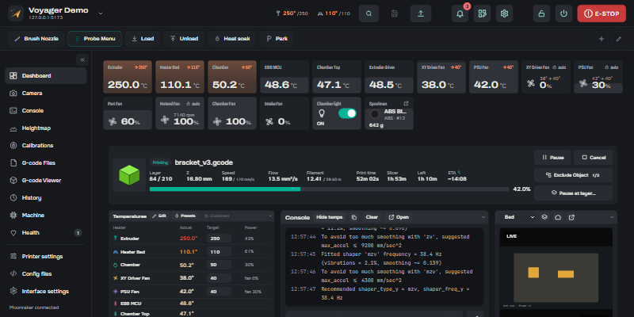](https://ozancs.github.io/voyager-ui/#/dashboard)

### Camera

Keep an eye on the print, switch between cameras and browse timelapses. A floating camera can follow you across pages; timelapse controls appear with moonraker-timelapse.

[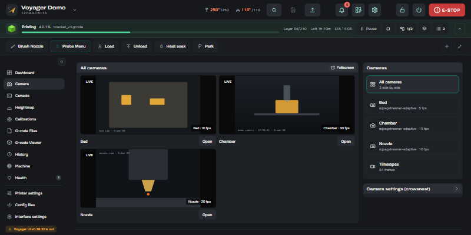](https://ozancs.github.io/voyager-ui/#/webcam)

### Console

Send commands, find earlier ones and read printer responses. Common Klipper errors include explanations to help you decide what to check next.

[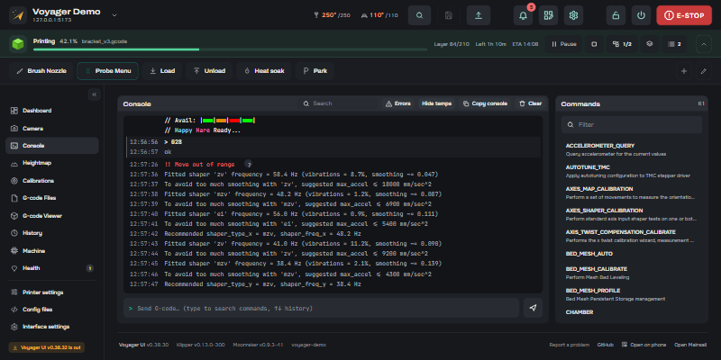](https://ozancs.github.io/voyager-ui/#/console)

### Heightmap

See the shape of your bed in 3D and compare saved meshes. Turn a table of measurements into something you can understand at a glance.

[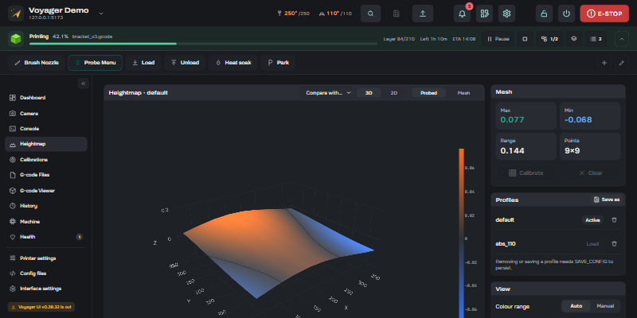](https://ozancs.github.io/voyager-ui/#/heightmap)

### Calibrations

Guided routines walk you through tuning. Calibration tools, results and the expandable Problem Solver live together, with Shake&Tune integration when installed.

[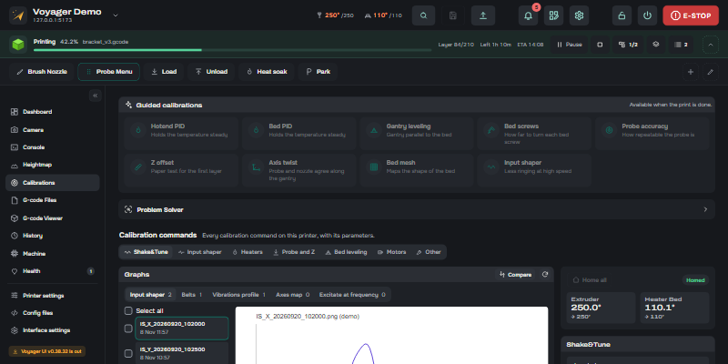](https://ozancs.github.io/voyager-ui/#/calibrations)

### G-code Files

Find the next print with thumbnails, folders and file details. Before starting, Voyager checks available material, nozzle and temperature information against your printer and active Spoolman spool.

[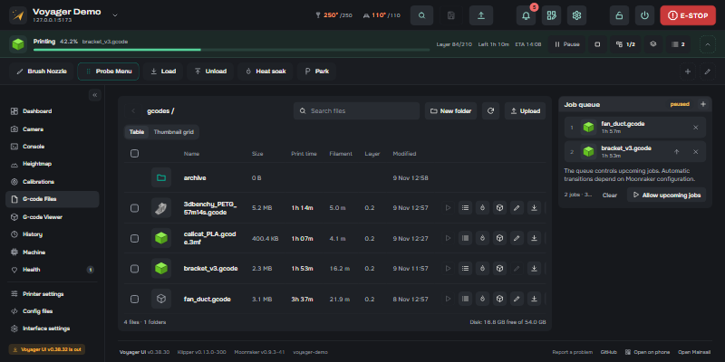](https://ozancs.github.io/voyager-ui/#/files)

### G-code Viewer

Inspect real toolpaths as solid extrusions, colour them by feature or speed, and step through layers. The demo opens a sliced PETG Benchy so you can explore an actual print.

[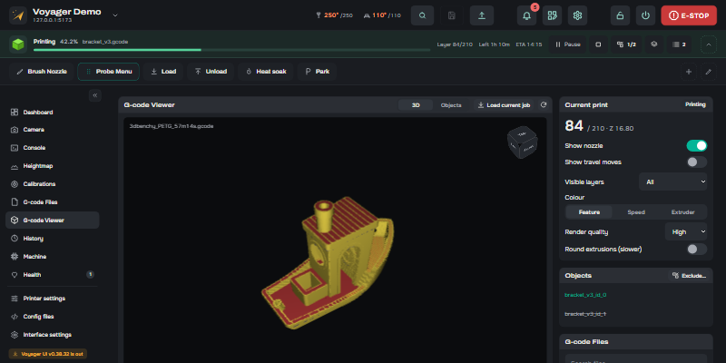](https://ozancs.github.io/voyager-ui/#/viewer)

### History

Look back through completed and interrupted jobs, review print times and find a file worth printing again.

[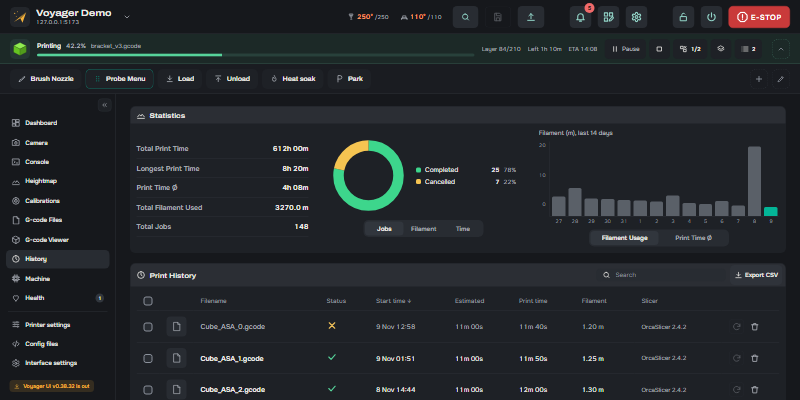](https://ozancs.github.io/voyager-ui/#/history)

### Machine

Manage updates, services and host information in one place. Voyager also appears in Moonraker’s update manager alongside your existing components.

[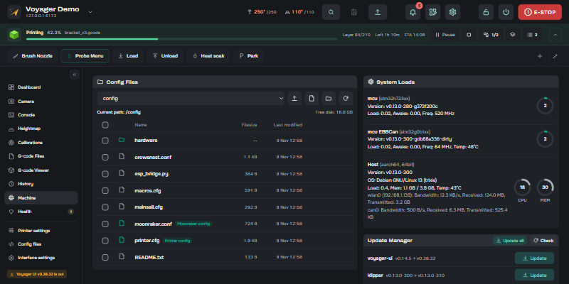](https://ozancs.github.io/voyager-ui/#/machine)

### Health

Spot connection errors, driver warnings and changes in heater behaviour. Maintenance reminders help keep routine care from becoming an afterthought.

[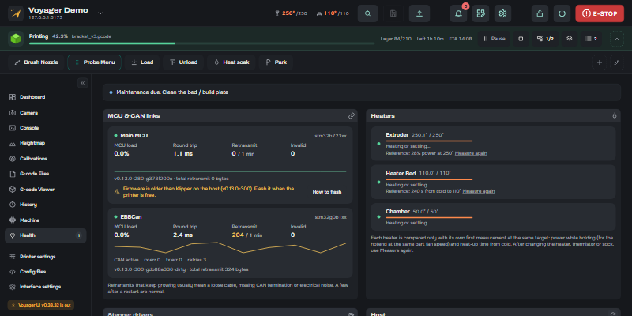](https://ozancs.github.io/voyager-ui/#/health)

### Printer settings

Reach common printer settings through readable fields instead of hunting through configuration files.

[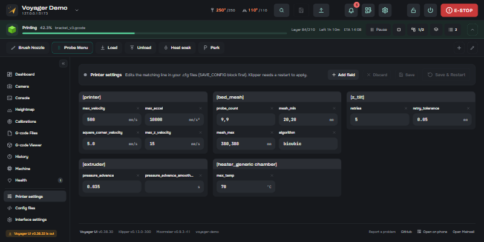](https://ozancs.github.io/voyager-ui/#/quick)

### Config files

Edit with Klipper-aware suggestions and checks, compare changes and return to an earlier version with saved-file history.

[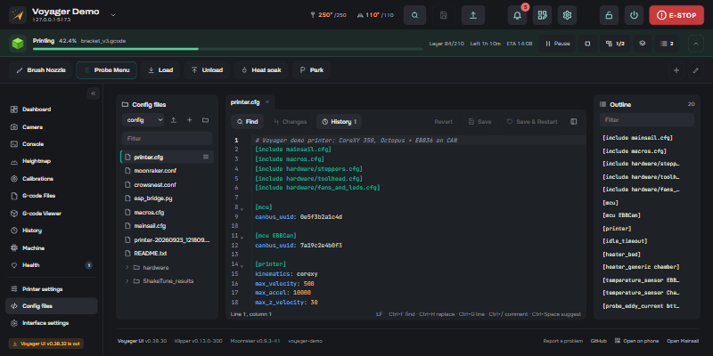](https://ozancs.github.io/voyager-ui/#/config)

### All printers

See progress and camera snapshots across your saved printers, then jump into the one that needs your attention.

[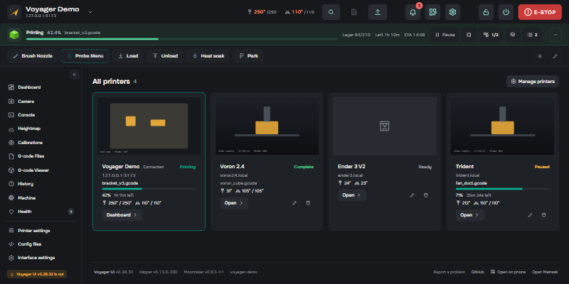](https://ozancs.github.io/voyager-ui/#/fleet)

### Interface settings

Choose the appearance, sounds, notifications and control preferences that suit your setup. Keep everyday interactions comfortable on the screens you actually use.

[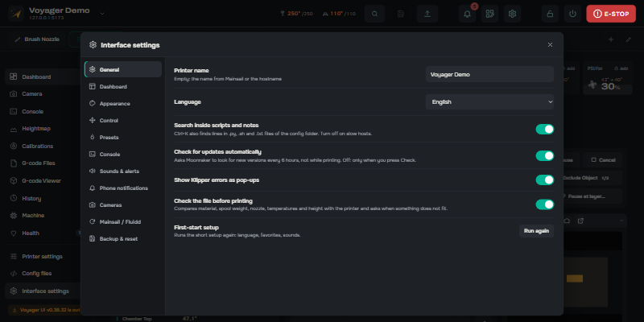](https://ozancs.github.io/voyager-ui/#/theme)

## Install

You need a Linux host running Klipper and Moonraker. If you already use Mainsail or Fluidd, you likely have the required nginx web server too; the installer checks the system before making changes.

Connect to your printer over SSH using its user name and IP address:

```bash
ssh pi@192.168.1.xxx
```

Then run:

```bash
curl -fsSL https://raw.githubusercontent.com/ozancs/voyager-ui/main/install.sh | bash
```

Follow the prompts and open the address printed at the end, normally **`http://<printer-ip>:1977`** — 1977 is the year Voyager 1 launched. Mainsail or Fluidd keeps its existing address. If the host runs several Moonraker instances, the installer finds them and lets you choose which to set up, assigning a port to each.

For custom ports, offline installs, removal or connections to other hosts, see [installation details](docs/INSTALLATION.md). Creality K1, Sonic Pad and other OpenWrt hosts are not supported by this installer.

### Updates

The installer registers Voyager with Moonraker’s Update Manager. Update it from **Machine → Update Manager**, or from Mainsail or Fluidd. Running the installer again also updates an existing installation.

### Uninstall

To remove Voyager, connect to the printer over SSH and run:

```bash
curl -fsSL https://raw.githubusercontent.com/ozancs/voyager-ui/main/install.sh | bash -s -- --uninstall
```

This removes the installer-managed Voyager installations on that host, their nginx sites and update-manager entries. Your Voyager settings remain in Moonraker’s database. Klipper, Moonraker, Mainsail and Fluidd stay installed.

## For the curious

**A lightweight addition to your printer.** Voyager is a static web app served by nginx. It does not need its own Python or Node server, background daemon or AI service on the printer. The interface and 3D rendering run in your browser. That keeps the extra work on the printer to serving files and handling Moonraker requests; cameras and frequent status requests still have a cost, and large 3D files use memory on the device viewing them.

**It fits into the setup you already have.** Voyager talks to Moonraker and leaves Klipper’s motion control to Klipper. Mainsail and Fluidd can stay installed and open alongside it. Integrations such as Spoolman, Moonraker Timelapse, Shake&Tune, Happy Hare, AFC and PA Sensei expose their controls when available; Voyager does not require you to replace those tools. AI helped build the code, but using Voyager does not require an AI account or send your printer to an AI service.

**Make it yours, without starting from scratch.** Voyager can import familiar presets from Mainsail or Fluidd. Custom cards, macro forms, favourites and separate print layouts let you keep your own workflow. Ctrl+K gets you to pages, files, macros and settings quickly. There are 14 interface languages; translation corrections are welcome.

**Room to experiment, ways to recover.** Config saves create backups, and the editor offers checks and change comparisons. Potentially disruptive actions ask for confirmation during a print, and a browser lock lets you leave a screen in viewing mode. Automated unit and browser layout checks help catch regressions as the project changes; real printer feedback remains just as valuable.

## Join in

<p align="center">
  <a href="https://discord.gg/KZWva6dq38"></a>
  <a href="https://www.youtube.com/@oznlab"></a>
  <a href="https://www.tiktok.com/@oznlab"></a>
</p>

Come talk printers, share your setup and help shape the next version on Discord. You can also find my builds and videos on YouTube and TikTok.

Found a bug, a confusing control or a missing feature? [Open an issue](https://github.com/ozancs/voyager-ui/issues). Include your setup and, when useful, a screenshot or the steps that led to it. You do not need to write code to help shape Voyager.

For local development, tests and the code layout, see [the development guide](docs/DEVELOPMENT.md).

## License

GPL-3.0. See [LICENSE](LICENSE). Additional icons come from [Lucide](https://lucide.dev) (ISC, see [LICENSE-lucide](LICENSE-lucide)).
